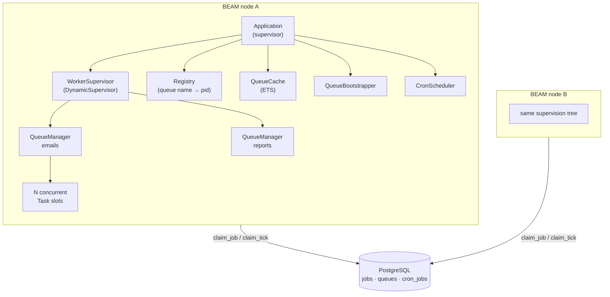

# Distributed Task Queue

**A job service any app can hand HTTP work to.** Tell it which URL to call and when (now, in ten minutes, or every morning at 9) and it makes sure the call happens, retrying through failures and setting aside whatever keeps failing. It works with any language, because all it needs is a URL.

Underneath, it is a background job queue that keeps running when a machine dies. Jobs are enqueued into PostgreSQL, claimed by worker processes across any number of BEAM nodes, retried with exponential backoff, and routed to a dead-letter queue once they exhaust their attempts. Scheduling is built in — cron expressions with real timezone and DST handling, or fixed intervals. A live web console shows what every queue is doing, surfaces failures, and lets you manage queues, jobs, the dead-letter queue and cron schedules without touching the API.

[](https://github.com/abwaocollins/distributed-task-queue/actions/workflows/ci.yml)


<!-- DEMO SLOT — live demo link and the kill-a-node GIF go here, above the fold. -->

---

## Why this exists

Elixir already has a mature job queue, and for production work you should use it. This project exists because I wanted to build the coordination primitives directly rather than consume them: exactly-one-claimer semantics under concurrency, safe scheduling across a cluster without a leader election, and failure handling that degrades predictably instead of silently.

The interesting parts are not the features — they are the two places where the obvious implementation was wrong, and the tests that proved it. See [Engineering notes](#engineering-notes).

## Architecture

Coordination lives in PostgreSQL, not in the cluster. Nodes never need to agree with each other, discover each other, or elect anything — they contend for rows. That trades peak throughput for a very small amount of distributed-systems surface area.



| Component | Responsibility |
|---|---|
| `QueueManager` | One GenServer per queue. Polls for claimable work, holds a fixed set of concurrency slots, traps exits so a crashed worker returns its slot. Self-terminates when idle. |
| `WorkerSupervisor` + `Registry` | Queues are started and stopped at runtime, addressed by name rather than pid. |
| `QueueCache` | GenServer-owned ETS table of queue metadata. `QueueManager` reads pause state from memory on every poll instead of hitting the database. |
| `QueueBootstrapper` | Starts a manager for every queue row at boot, via `handle_continue`. |
| `CronScheduler` | Self-scheduling poll loop. Runs on **every** node — safety comes from atomic tick claiming, not from being a singleton. |
| `Worker` | The behaviour user code implements, plus the dispatch trust boundary. |
| `Events` | Bridges the `[:dtq, :job, …]` / `[:dtq, :cron, …]` telemetry events onto `Phoenix.PubSub`, so the console hears about work done on any node. |
| Web console | LiveView pages under one `live_session`, reading through a bounded read model (`Dashboard`) and kept current by a shared `on_mount` hook (`LiveRefresh`). |

### How a job flows

1. **Enqueue** — a row lands in `jobs` with status `pending`, a `worker_module` string, and a JSON payload.
2. **Claim** — the queue's `QueueManager` claims one row inside a transaction, using `SELECT … FOR UPDATE SKIP LOCKED` followed by a targeted `UPDATE` while the lock is still held. Status becomes `started` and `attempted_by` records which node took it.
3. **Dispatch** — `worker_module` is resolved to a real module (see [the trust boundary](#the-worker_module-trust-boundary)) and `perform/1` is called in a supervised task.
4. **Settle** — `:ok` marks the job `completed`. An error or a raise marks it `retryable` with `next_retry_at = now + min(15 × 2^attempts, 3600)` seconds, or `discarded` once `attempts` reaches `max_attempts`.
5. **Dead-letter** — discarded jobs are flagged `dead_letter: true`, keeping their original queue so they can be inspected and requeued.
6. **Rescue** — a job left `started` by a worker that died is put back for retry by the `Reaper` (see [Orphaned jobs](#orphaned-jobs)).

Every enqueue goes through `add_job/2`, which starts the queue's manager or wakes it if it is already running — so a new job is picked up immediately, even on a queue whose other slots are busy with slow jobs.

**Delivery semantics:** at-least-once for jobs. Cron *ticks* are deliberately at-most-once — the schedule advances before the job is inserted, so a crash in that window drops one tick rather than double-firing it. That trade-off is commented at the call site.

## Capabilities

| | |
|---|---|
| **Race-safe claiming** | No two workers run the same job, verified against real concurrent connections rather than reasoned about |
| **Exponential backoff** | `min(15 × 2^attempts, 3600)` seconds, capped at one hour |
| **Dead-letter queue** | Exhausted jobs are retained and queryable; requeue one or all |
| **Queue pause / resume** | Stops claiming; in-flight jobs finish; the manager stays alive |
| **Runtime queue management** | Create, edit, pause, and delete queues without a deploy, from the console or the API |
| **Cron scheduling** | Cron expressions or fixed intervals, with timezone and DST handling |
| **Overlap policy** | Per-cron control over whether a run may start while the previous one is still going |
| **Crash isolation** | A worker crash returns its concurrency slot; it cannot take down the queue |
| **Orphan rescue** | Jobs stranded in `started` by a dead node are retried, or dead-lettered on their last attempt |
| **Live reconfiguration** | Concurrency changes, resumes and new cron jobs take effect immediately — no restart |
| **Authentication** | Bearer API keys for `/api/*`; basic auth for the console and LiveDashboard |
| **Webhook jobs** | Call any URL now, later or on a schedule; signed requests, per-attempt delivery history, SSRF protection |
| **Future scheduling** | `scheduled_at` for one-off delayed jobs |
| **Telemetry** | `[:dtq, :job, …]` and `[:dtq, :cron, …]` events, wired into LiveDashboard and the console |
| **Web console** | Live overview, filterable job list, per-job detail, and create / edit / delete for queues, jobs and cron jobs |

## Web console

`mix phx.server` serves a LiveView console at `/`. Every page updates live as jobs run.

| Page | What it is for |
|---|---|
| **Overview** `/` | Job totals (each links to the filtered list), recent failures with their errors, the next cron runs, and a *Needs attention* panel. |
| **Queues** `/queues` | Depth, in-flight work against concurrency, retrying and dead counts per queue. Create, edit, pause/resume, delete. |
| **Jobs** `/jobs` | Filter by queue, status or "has an error", or search by job id, worker or error text. Filters live in the URL, so a filtered view can be bookmarked or linked. Create a job with a JSON payload; delete. |
| **Job detail** `/jobs/:id` | Full error message, payload, attempt count, which node claimed it, and a timeline from enqueue to completion or discard. Requeue if dead-lettered. |
| **Dead letter** `/dead-letter` | Exhausted jobs with their last error, filterable by queue or text. Requeue one, requeue exactly the jobs the filter shows, or delete. |
| **Cron** `/cron` | Schedules with next and last run. Create and edit with a cron expression plus timezone, or a fixed interval; enable/disable; delete. |

**Errors are shown where they happen, not only in logs.** The *Needs attention* panel flags crons pointing at a queue that does not exist (with a one-click fix), jobs marked running on a queue with no manager on this node (possible orphans), paused queues with work waiting, and dead-lettered jobs. The nav carries a dead-letter count, every job row shows its last error, and forms validate inline, including JSON payloads, module names, cron expressions and timezones.

**How it stays live.** `DistributedTaskQueue.Events` forwards the job and cron telemetry events to PubSub, which reaches every connected node. Each page coalesces them: the first event schedules a refresh 300 ms later and any that arrive in between ride along, so a burst of completions costs one reload. The delay also avoids a stale read, since a worker emits `:completed` just *before* it writes the new status. A 5-second tick covers what telemetry does not report, such as jobs enqueued through the API.

A few behaviours worth knowing:

- **Concurrency changes apply immediately.** Raising it starts waiting jobs; lowering it lets in-flight jobs finish rather than killing them. Only the node you are on is resized — other nodes pick it up when their manager next starts.
- **Cron jobs declared in config are re-applied at every boot**, so console edits to them last until the next restart. The console labels them `config` and says so in the edit form.
- **A cron job created from the console fires on time**, even seconds after it is saved: saving wakes the scheduler, and the enqueue wakes the queue.

`/admin/dashboard` exposes LiveDashboard (behind admin basic auth wherever credentials are configured), with the `dtq.*` metrics alongside the BEAM's own.

## Defining a worker

Implement the behaviour and return `:ok` or `{:error, reason}`. Raising is also fine — it is caught and recorded as a failure.

```elixir
defmodule MyApp.EmailWorker do
  @behaviour DistributedTaskQueue.Worker

  @impl true
  def perform(%{"to" => to, "subject" => subject}) do
    case MyApp.Mailer.deliver(to, subject) do
      {:ok, _}      -> :ok
      {:error, err} -> {:error, err}
    end
  end
end
```

### The `worker_module` trust boundary

`worker_module` arrives as a string from client input on any deployment that exposes the HTTP API, which makes dispatch a security boundary. Two properties are enforced in `DistributedTaskQueue.Worker.resolve/1`:

- **No atom creation.** Resolution uses `Module.safe_concat/1`, which raises rather than interning an atom for a name the VM has never seen. `Module.concat/1` would mint one per call, and atoms are never garbage collected — an unbounded stream of unknown module names would exhaust the atom table and take the node down.
- **Opt-in only.** Exporting `perform/1` is not consent to be executed as a worker. The module must declare `@behaviour DistributedTaskQueue.Worker`. Without that check, *any* loaded module exporting `perform/1` is reachable with a caller-controlled payload.

Rejected dispatches fail the job with an explicit reason rather than crashing the queue.

## Enqueuing work

From the console, use **New job** on the Jobs page. In Elixir:

```elixir
DistributedTaskQueue.add_queue(%{name: "emails", max_concurrent_jobs: 10})

DistributedTaskQueue.add_job("emails", %{
  worker_module: "MyApp.EmailWorker",
  payload: %{"to" => "someone@example.com", "subject" => "Hello"},
  max_attempts: 5
})
```

Over HTTP (the `authorization` header is only needed where API keys are configured — see [Authentication](#authentication)):

```bash
curl -X POST localhost:4000/api/queues \
  -H "authorization: Bearer $DTQ_API_KEY" \
  -H 'content-type: application/json' \
  -d '{"name": "emails", "max_concurrent_jobs": 10}'

curl -X POST localhost:4000/api/jobs \
  -H "authorization: Bearer $DTQ_API_KEY" \
  -H 'content-type: application/json' \
  -d '{"queue_name": "emails",
       "worker_module": "MyApp.EmailWorker",
       "payload": {"to": "someone@example.com"}}'
```

### HTTP API

| Method | Path | Purpose |
|---|---|---|
| `GET` | `/api/queues` | List queues |
| `POST` | `/api/queues` | Create a queue |
| `POST` | `/api/queues/:name/start` | Start a queue's manager |
| `POST` | `/api/queues/:name/stop` | Stop a queue's manager |
| `DELETE` | `/api/queues/:name` | Delete a queue and cascade its jobs |
| `GET` | `/api/jobs` | List jobs (filterable) |
| `GET` | `/api/jobs/:id` | Fetch one job |
| `POST` | `/api/jobs` | Enqueue a job |
| `POST` | `/api/webhooks` | Enqueue a webhook: an HTTP request to deliver now or later (see [Webhooks](#webhooks)) |
| `DELETE` | `/api/jobs/:id` | Soft-delete a job |
| `POST` | `/api/jobs/:id/requeue` | Requeue one dead-lettered job |
| `POST` | `/api/jobs/requeue_dead_letter` | Requeue every dead-lettered job |
| `GET` | `/api/cron_jobs` | List cron jobs |
| `GET` | `/api/cron_jobs/:id` | Fetch one cron job |
| `POST` | `/api/cron_jobs` | Create a cron job (first run computed from now); takes a `webhook` object in place of `worker_module` + `payload` |
| `PATCH` | `/api/cron_jobs/:id` | Update a cron job (`enabled`, `next_run_at`, `last_run_at` are ignored) |
| `DELETE` | `/api/cron_jobs/:id` | Delete a cron job |
| `POST` | `/api/cron_jobs/:id/enable` | Enable, restarting the schedule from now (no catch-up run) |
| `POST` | `/api/cron_jobs/:id/disable` | Disable |

Responses use conventional status codes — `401` for a missing or wrong API key, `404` for missing resources, `409` for conflicting state transitions, `422` for changeset errors, and idempotent `200`s where repeating a call is harmless.

### Authentication

| Surface | Mechanism | Configured by |
|---|---|---|
| `/api/*` | `Authorization: Bearer <key>` | `DTQ_API_KEYS` (comma-separated), plus `DTQ_DEMO_API_KEY` if set |
| Console and `/admin/dashboard` | HTTP basic auth | `DTQ_ADMIN_USERNAME`, `DTQ_ADMIN_PASSWORD` |

Open in development and test. In production the API is **locked** when `DTQ_API_KEYS` is unset, and the app **refuses to boot** without admin credentials — unless `DTQ_PUBLIC_CONSOLE=true` is set deliberately, which opens the console (for a public demo) but keeps LiveDashboard closed. Basic auth is checked on the initial request *and* when the LiveView socket mounts, since the socket is a separate connection the plug never sees.

Webhook deliveries add three more settings:

| Variable | Effect |
|---|---|
| `DTQ_WEBHOOK_SECRET` | Signs every outgoing webhook ([how receivers verify it](#verifying-the-signature)). **Required in production**: the app refuses to boot without it, rather than send unsigned requests. Generate one with `mix phx.gen.secret`. |
| `DTQ_WEBHOOK_TARGETS` | `demo` restricts webhooks to the built-in demo receivers (for a public deployment); anything else allows any public URL. |
| `DTQ_DEMO_API_KEY` | An extra, deliberately published API key for a public demo. It is a real key, so set it only where that is intended; combined with `DTQ_WEBHOOK_TARGETS=demo` it can reach nothing but the demo receivers. |

## Webhooks

A webhook job is one HTTP request that the service delivers for you. It is an ordinary row in `jobs`, claimed and retried by the same machinery as any other job, so it inherits backoff, the dead-letter queue and orphan rescue. A built-in worker (`DistributedTaskQueue.Workers.Webhook`) makes the request and records every attempt.

```bash
curl -X POST localhost:4000/api/webhooks \
  -H "authorization: Bearer $DTQ_API_KEY" \
  -H 'content-type: application/json' \
  -d '{"url": "https://example.com/hooks/invoice-paid",
       "method": "POST",
       "headers": {"authorization": "Bearer their-token"},
       "body": {"invoice": 4021},
       "delay_seconds": 600,
       "max_attempts": 5}'
```

That returns `201` with the job, whose id works with `GET /api/jobs/:id`; for webhook jobs the response includes the delivery attempts. Only `url` is required. The rest:

| Field | Default | Notes |
|---|---|---|
| `method` | `POST` | `GET`, `POST`, `PUT`, `PATCH`, `DELETE` |
| `headers` | none | string to string |
| `body` | none | a string, or a JSON object/array (sent as `application/json` unless you set a content type) |
| `timeout_ms` | 15 000 | capped at 60 000 |
| `queue` | `webhooks` | the `webhooks` queue (concurrency 10) is created at boot if missing and never overwritten |
| `max_attempts` | 5 | |
| `delay_seconds` or `run_at` | now | deliver later; `run_at` is ISO 8601 with an offset. Give one, not both |

The request is validated when the job is created, so a bad URL or method is a `422` now rather than a surprise at delivery time. The console's **New job** and **New cron** forms ("Call a URL") do the same without code, and show cron schedules in plain English ("Every day at 02:00 (Africa/Nairobi)").

### What counts as delivered

| Response | Outcome |
|---|---|
| any 2xx | completed |
| 408, 429, any 5xx | failed attempt: retried with the usual exponential backoff, dead-lettered when attempts run out |
| timeout, connection refused, DNS failure, TLS error | failed attempt: retried |
| any other 4xx (400, 401, 404, 422, ...) | **permanent**: dead-lettered at once, since retrying cannot help |
| a 3xx | permanent: redirects are not followed, and the error says so |
| any other unexpected status (1xx, 600 and above) | permanent: dead-lettered |
| a target blocked by the safety rules below | permanent |

Dead-lettering a permanent failure straight away uses a small extension to the worker contract: `perform/1` may return `{:discard, reason}` to skip the remaining attempts. Existing workers returning `:ok` or `{:error, _}` are unaffected. Every attempt is stored in `webhook_deliveries` (request URL and method, status, duration, the first 2 KB of the response, the error), shown as an attempts table on the job's detail page, and deleted with the job.

### What the receiver sees

Every request carries these headers, and a caller-supplied header of the same name cannot override them:

| Header | Meaning |
|---|---|
| `x-dtq-job-id` | The job id, **stable across retries**. |
| `x-dtq-attempt` | 1-based attempt number. |
| `x-dtq-signature` | `t=<unix seconds>,v1=<hex HMAC-SHA256>` — see below. Omitted when no secret is configured (dev and test). |
| `user-agent` | `dtq-webhook/<version>` |

**Delivery is at-least-once.** A timeout can hide a request that actually succeeded, so a receiver should use `x-dtq-job-id` as an idempotency key: remember the ids it has handled and acknowledge repeats without redoing the work.

### Verifying the signature

The signature is the Stripe scheme: HMAC-SHA256, keyed with `DTQ_WEBHOOK_SECRET`, over the string `"<t>.<raw body>"`. Verify against the **raw bytes** of the body (not re-serialised JSON), compare in constant time, and reject old timestamps so a captured request cannot be replayed later.

```python
import hmac, hashlib, time

def verify(secret: str, raw_body: bytes, header: str, tolerance: int = 300) -> bool:
    try:
        parts = dict(p.split("=", 1) for p in header.split(","))
        t, sig = parts["t"], parts["v1"]
        age = abs(time.time() - int(t))
    except (KeyError, ValueError, AttributeError):
        return False  # malformed header: fail closed
    if age > tolerance:
        return False
    expected = hmac.new(secret.encode(), f"{t}.".encode() + raw_body, hashlib.sha256).hexdigest()
    return hmac.compare_digest(expected.encode(), sig.encode())
```

```javascript
const crypto = require("crypto");

function verify(secret, rawBody, header, toleranceSeconds = 300) {
  const parts = Object.fromEntries(header.split(",").map((p) => p.split("=")));
  const t = Number(parts.t);
  if (!Number.isFinite(t) || !parts.v1) return false; // malformed header: fail closed
  if (Math.abs(Date.now() / 1000 - t) > toleranceSeconds) return false;
  const expected = crypto
    .createHmac("sha256", secret)
    .update(`${parts.t}.`)
    .update(rawBody) // a Buffer of the raw body, not parsed JSON
    .digest("hex");
  const a = Buffer.from(expected), b = Buffer.from(parts.v1);
  return a.length === b.length && crypto.timingSafeEqual(a, b);
}
```

### Not an open proxy

A service that makes requests for strangers is an SSRF risk, so:

- **Private addresses are blocked.** Before connecting, the resolved address must not be loopback, private, link-local (including the `169.254.169.254` cloud metadata address), IPv6 unique-local or unspecified. Blocked targets fail permanently with a clear message. This is on in production and off in dev and test (`config :distributed_task_queue, :webhooks, allow_private_targets: true`), so `localhost` receivers work while developing.
- **Redirects are never followed**, so a public URL cannot bounce a request inward.
- **`DTQ_WEBHOOK_TARGETS=demo` restricts a deployment to the demo receivers.** Anything else is rejected when the job is created, and again at delivery for jobs that predate the change. The public demo runs this way, because an open console with a free URL field would otherwise let any visitor make the server send signed, retried requests to any website.
- **Secrets in headers are redacted on display.** The console and API responses show `••••` for `authorization`, `cookie`, `proxy-authorization` and any header whose name contains `token`, `secret`, `key` or `signature`. See [Known limitations](#known-limitations) for what that does not cover.

### Recurring webhooks

Recurring deliveries use the cron API with a `webhook` object (the same fields as above) in place of `worker_module` and `payload`:

```bash
curl -X POST localhost:4000/api/cron_jobs \
  -H "authorization: Bearer $DTQ_API_KEY" \
  -H 'content-type: application/json' \
  -d '{"name": "nightly-sync",
       "queue_name": "webhooks",
       "cron_expression": "0 2 * * *",
       "timezone": "Africa/Nairobi",
       "webhook": {"url": "https://example.com/hooks/sync", "method": "POST"}}'
```

### The demo

With `DTQ_DEMO_MODE=true` the service tells its story through webhooks. A fictional shop, **Acme Store**, places an order every ten seconds; each order becomes three webhooks to in-app receivers (Payments, Email, Warehouse) that answer after a short random delay and occasionally fail, and a "daily sales report" webhook runs on a schedule. A **Demo controls** panel switches each receiver Online or Offline: take the Warehouse offline and its jobs start retrying with growing delays; bring it back and the backlog drains, and anything that ran out of attempts lands in Dead letter, where one click requeues it. Offline switches reset by themselves after five minutes. The Overview page opens with a short plain-English intro for first-time visitors.

## Scheduled jobs

A cron job declares **either** a `cron_expression` **or** an `interval_seconds`, never both — enforced by a database check constraint (`num_nonnulls(cron_expression, interval_seconds) = 1`), not only by the changeset.

```elixir
config :distributed_task_queue, :cron_jobs, [
  %{
    name: "daily_report",
    worker_module: "MyApp.DailyReportWorker",
    queue_name: "reports",
    cron_expression: "0 9 * * *",
    timezone: "Africa/Nairobi",
    payload: %{}
  },
  %{
    name: "cleanup",
    worker_module: "MyApp.CleanupWorker",
    queue_name: "low",
    interval_seconds: 3600,
    payload: %{}
  }
]
```

Entries are upserted on `name` at boot. `next_run_at` is only recomputed when the schedule itself changed, so redeploying does not indefinitely defer a job that is due.

**Timezones are resolved at schedule time and stored as UTC.** DST edges are handled explicitly rather than left to crash twice a year: a time that falls in a spring-forward gap resolves to the instant the clock jumps to, and an ambiguous autumn time resolves to the first occurrence. Setting a `timezone` on an interval-based schedule — where it would silently mean nothing — is rejected by a check constraint.

**Running the scheduler on every node is safe.** Before enqueuing, a node claims the tick with a conditional update:

```sql
UPDATE cron_jobs SET next_run_at = ..., last_run_at = ...
 WHERE id = $1 AND enabled AND next_run_at <= now()
```

PostgreSQL serialises the row write, so exactly one node sees `count == 1` and owns that tick. No leader election, no `:global`, no singleton process to supervise.

## Orphaned jobs

A job whose worker dies mid-run — node lost, process killed — stays `started`, and nothing else ever moves it. `DistributedTaskQueue.Reaper` rescues such jobs on two rules:

- **Stale:** `started` longer than `rescue_after_seconds` (default one hour), checked every minute. Set it above your slowest job's runtime, or that job will run twice.
- **Own node at boot:** a named node that just started cannot still be running the jobs it had marked `started`, so it rescues them immediately. Skipped on unnamed nodes, since every one of them is `nonode@nohost`.

A rescued job is treated as a failed attempt: back to `retryable` with backoff, or dead-lettered if it was on its last one. Jobs this node's manager is actually running are never rescued, however long they take, and rows are locked `FOR UPDATE SKIP LOCKED` so a reaper on every node is safe. Each rescue emits `[:dtq, :job, :rescued]`.

```elixir
config :distributed_task_queue, :reaper, rescue_after_seconds: 3_600, interval_ms: 60_000
```

## Engineering notes

The two most useful things in this repository are the bugs.

### Job claiming was not race-safe

The original claim was a single statement:

```sql
UPDATE jobs AS j0 SET worker_id = ..., status = 'started'
 WHERE j0.id IN (SELECT sj0.id FROM jobs AS sj0
                  WHERE sj0.worker_id IS NULL AND ... LIMIT 1)
```

Every guard lived in the subquery, which scans `jobs` under a *different* range-table entry. Under `READ COMMITTED`, an `UPDATE` that blocks on another transaction's row lock re-evaluates its `WHERE` clause against the newly committed row — but that substitution applies only to the relation the `UPDATE` targets. The subquery re-ran against the old snapshot, still returned the same id, and the second claimer updated the row anyway. Both workers ran the job, and because `attempted_by` kept only the last writer, **the duplicate left no trace in the data.**

The first fix — adding `FOR UPDATE SKIP LOCKED` to the subquery — stopped the double-claim and introduced something worse. PostgreSQL may evaluate that subplan once per candidate row, and with `SKIP LOCKED` each evaluation can return a different id, so one statement marked several rows `started`. The code matched on a single row, fell through to `{:error, :no_jobs}`, and left those rows stranded in `started` with nobody running them.

What shipped is a select-then-update inside a transaction, so the lock is held across both statements and there is nothing to re-evaluate. The committed trial harness (`mix test --only trials`) measured **0 duplicates, 0 stranded rows and 0 lost rows** over 40 trials of 5 jobs × 5 concurrent claimers, and over 200 trials of 10 × 10; every job was claimed in every trial of both runs. Throughput per burst is best-effort rather than guaranteed: a claimer that loses the race comes back empty and tries again on its next poll, which costs one poll cycle, never a job.

The test module for this opts out of the Ecto sandbox deliberately — the sandbox hands every process in a test the same connection, so anything that *looks* concurrent is silently serialised and proves nothing. Locks are held from a raw Postgrex connection to force the exact interleaving rather than hoping for it.

→ [Full writeup: race-safe job claiming](docs/engineering/race-safe-job-claiming.md) — the SQL, the forced interleaving, and the failed first fix in detail.

### A cron job silently disabled itself

A cron pointed at a queue name that had no corresponding row. Enqueuing succeeded — the changeset validated that `queue_name` was *present*, never that the queue existed — and the helper meant to start a manager for it returned `:ok` after doing nothing. The job was unclaimable forever, and because the cron's overlap policy saw a permanently `pending` previous run, it never fired again. It ran exactly once and stopped, logging only the symptom.

The fix was to make the impossible state unreachable and loud: the scheduler now checks for a missing queue *before* claiming the tick, so no orphan job is created and `next_run_at` is left unclaimed — meaning the cron self-heals the moment the queue is created. Boot logs every enabled cron whose target queue is absent, at `error` level, with the remedy in the message.

The broader lesson is in the class of bug, not the instance: the failure mode is not "a worker died mid-run", it is **"a job that can never be claimed"** — which includes anything enqueued into a queue with no running manager.

→ [Full writeup: the cron wedge incident](docs/engineering/cron-wedge-incident.md) — the investigation, the fixes, and the design correction it forced.

## Observability

Telemetry events are emitted for every job and cron transition and registered as LiveDashboard metrics:

| Event | Measurements | Metadata |
|---|---|---|
| `[:dtq, :job, :started]` | `system_time` | `job_id`, `queue_name`, `worker_module` |
| `[:dtq, :job, :completed]` | `duration` | `job_id`, `queue_name`, `worker_module` |
| `[:dtq, :job, :failed]` | `duration` | …plus `reason` |
| `[:dtq, :job, :rescued]` | `count` | `job_id`, `queue_name`, `worker_module`, `reason` (`:stale`, `:node_restarted`) |
| `[:dtq, :cron, :fired]` | | `cron_job_id`, `name` |
| `[:dtq, :cron, :skipped]` | | …plus `reason` (`:queue_paused`, `:previous_run_active`, `:queue_missing`) |
| `[:dtq, :cron, :failed]` | | …plus `reason` |

`:skipped` carrying a reason is what turned the cron incident above from invisible into diagnosable. The same events drive the [web console](#web-console), bridged onto PubSub.

## Testing

```bash
mix test              # full suite
mix test --only trials  # repeated-trial claim harness (DTQ_TRIALS, DTQ_JOBS, DTQ_CLAIMERS)
mix coveralls.html    # coverage report
mix credo             # linting
mix dialyzer          # type checking
```

339 tests, covering the API controllers and their authentication, every console page (filters, create/edit/delete, inline validation, live refresh from telemetry), the bootstrapper, cron scheduling and overlap policy, the ETS cache, pause semantics, live reconfiguration, orphan rescue, worker dispatch and its security boundary, webhook validation, signing, delivery outcomes and target safety, the demo receivers, and a dedicated concurrency suite that drives real parallel connections. CI runs the suite against PostgreSQL on every push and pull request.

## Running locally

Requires Elixir ~> 1.15, OTP 25+, and PostgreSQL 14+.

```bash
mix setup       # deps, database create + migrate, assets
mix phx.server  # http://localhost:4000
```

Then open http://localhost:4000 for the [web console](#web-console). Set `DTQ_DEMO_MODE=true` to have `DistributedTaskQueue.Demo` start the Acme Store pipeline described under [Webhooks](#the-demo): a `demo` queue, the `acme-orders` and `acme-daily-sales-report` cron jobs, and the three in-app receivers. It prunes old finished jobs (and their deliveries) from the `demo` and `webhooks` queues only. The cron jobs it creates live in the database and keep firing after demo mode is turned off, so delete them if you only wanted a look. Webhooks to `localhost` work in development because the private-address check is off there.

## Deploying

The repo ships a release (`mix phx.gen.release --docker`: `Dockerfile`, `bin/migrate`) and a `fly.toml`. On Fly.io:

```bash
fly launch --no-deploy          # reuse fly.toml; pick an app name
fly postgres create && fly postgres attach <db-app>   # sets DATABASE_URL
fly secrets set SECRET_KEY_BASE=$(mix phx.gen.secret) DTQ_API_KEYS=<key> \
  DTQ_WEBHOOK_SECRET=$(mix phx.gen.secret)
fly deploy
fly scale count 3               # nodes find each other over <app>.internal
```

`rel/env.sh.eex` names each node after its private IPv6 address and points `DNS_CLUSTER_QUERY` at `<app>.internal`, so scaled machines join one BEAM cluster. As committed, `fly.toml` runs a **public demo** — `DTQ_PUBLIC_CONSOLE=true`, `DTQ_DEMO_MODE=true` and `DTQ_WEBHOOK_TARGETS=demo`, which confines webhooks to the built-in receivers. Optionally set `DTQ_DEMO_API_KEY` to publish a key that lets visitors `curl` the demo. Remove the three and set `DTQ_ADMIN_USERNAME` / `DTQ_ADMIN_PASSWORD` for a private deployment; `DTQ_WEBHOOK_SECRET` is required either way.

## Known limitations

Deliberately listed, because they are the questions worth asking:

- **Orphan rescue is threshold-based, not a heartbeat.** A node that dies is detected only after `rescue_after_seconds`, and a job that legitimately runs longer than that is run twice. A per-node lease would detect death in seconds; it has not been needed yet.
- **Wake-ups are local to a node.** Enqueuing on node A wakes A's manager, not B's; B finds the work on its next poll. Enqueuing inside the caller's own transaction wakes the manager before the row is visible, so that job also waits for the next poll. The standard fix for both is `LISTEN/NOTIFY` after commit.
- **A public console is fully interactive.** With `DTQ_PUBLIC_CONSOLE=true` anyone can pause, delete and requeue. Fine for a demo whose data is regenerated; there is no read-only mode or rate limit.
- **Clustering is configured but not yet demonstrated.** `DNSCluster` is wired into the supervision tree and defaults to `:ignore`. Multi-node coordination is correct by construction — every claim path is a row contention — but the deployed proof is still to come.
- **DNS rebinding between check and connect.** The private-address check resolves the hostname, then the HTTP client resolves it again to connect. A hostile DNS server could answer differently the second time. Pinning the connection to the checked address would close it; it has not been done.
- **Stored header values are not encrypted at rest.** Credentials a caller puts in webhook `headers` sit in the job payload in plain text. They are redacted on display in the console and API, not protected in the database.
- **A kept secret follows an edited URL.** In `:any` mode with a public console, editing a webhook cron's URL while leaving a masked header (`••••`) unchanged sends the stored secret to the new URL. Don't run a public console in `:any` mode.
- **`Retry-After` is ignored.** Every retry uses the same exponential backoff, even when a receiver asks for a specific delay.
- **Webhook delivery is at-least-once.** Receivers must dedupe on `x-dtq-job-id`; there is no exactly-once mode.
- **Throughput has a ceiling.** Coordinating through row locks means the database is the bottleneck under a single hot queue. That is the accepted cost of not running a broker.
